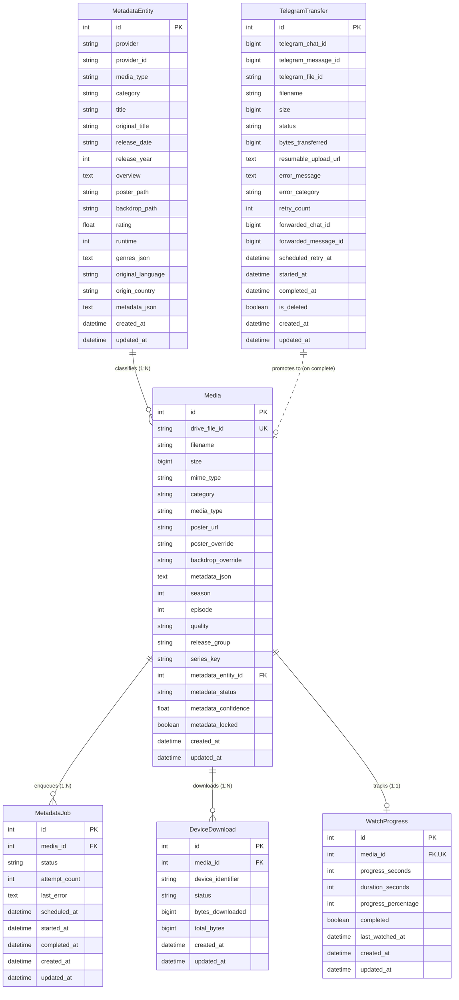

# StreamX: Media Data Model & Relational Schema

**Document Version:** 1.0.0  
**Updated:** October 2026  
**System:** StreamX Media Data Architecture

---

## 1. Domain Entities & Conceptual Separation

StreamX enforces a strict separation between four fundamental media concepts:
1. **Source File / Transfer Record (`TelegramTransfer`):** Provider-specific physical message or upload task in Telegram, holding `telegram_file_id`, chat ID, byte offsets, and error state.
2. **Physical Cloud Media Item (`Media`):** Master storage reference on Google Drive, holding `drive_file_id`, filename, size, MIME type, technical properties (season, episode, quality), and shelf category.
3. **Canonical Metadata Entity (`MetadataEntity`):** Creative work identity obtained from TMDB or AniList (canonical title, overview, poster path, backdrop path, rating, genres, runtime).
4. **Enrichment Lifecycle Job (`MetadataJob`):** Asynchronous task tracking metadata retrieval attempts, status, and retry schedules.
5. **Consumption State (`WatchProgress`, `DeviceDownload`):** User playback positions, completion status, and device-local offline download progress.

---

## 2. Entity-Relationship Diagram

---

## 3. Detailed Model Specifications

### 3.1 `Media` Table
Represents master files stored in Google Drive.
- `id` (INTEGER, PK): Internal surrogate key.
- `drive_file_id` (VARCHAR(255), UNIQUE, INDEXED): Stable, immutable Google Drive file identifier.
- `filename` (VARCHAR(512), INDEXED): Current filename on Google Drive.
- `size` (BIGINT): File size in bytes.
- `mime_type` (VARCHAR(128)): Detected MIME type (e.g. `video/x-matroska`, `video/mp4`).
- `category` (VARCHAR(64), INDEXED): UI shelf grouping (`Movies`, `TV Shows`, `Anime`, `Other`).
- `media_type` (VARCHAR(32), INDEXED): Taxonomy enum (`MOVIE`, `TV_SERIES`, `TV_EPISODE`, `ANIME_SERIES`, `ANIME_EPISODE`, `ANIME_MOVIE`, `OTHER`).
- `season` (INTEGER, INDEXED): Parsed season number (nullable).
- `episode` (INTEGER, INDEXED): Parsed episode number (nullable).
- `quality` (VARCHAR(64)): Detected resolution (e.g. `1080p`, `4K UHD`, `720p`).
- `release_group` (VARCHAR(128)): Extracted fansub/release group (e.g. `SubsPlease`, `Erai-raws`).
- `series_key` (VARCHAR(256), INDEXED): Normalized grouping key linking all episodes of a series (e.g. `canonical_tmdb_1396`).
- `metadata_entity_id` (INTEGER, FK $\to$ `metadata_entities.id`): Linked canonical creative work.
- `metadata_status` (ENUM): `PENDING`, `PROCESSING`, `MATCHED`, `LOW_CONFIDENCE`, `NOT_FOUND`, `MANUAL`, `FAILED`, `RETRYING`.
- `metadata_confidence` (FLOAT): Match confidence score between 0.0 and 1.0.
- `metadata_locked` (BOOLEAN): When `True`, automated enrichment workers will NEVER overwrite this record.

### 3.2 `MetadataEntity` Table
Represents the deduplicated creative work.
- `id` (INTEGER, PK): Internal entity ID.
- `provider` (VARCHAR(64), INDEXED): External catalog provider (`tmdb` or `anilist`).
- `provider_id` (VARCHAR(128), INDEXED): External ID (e.g. TMDB ID `157336`, AniList ID `133965`).
- `media_type` (VARCHAR(32), INDEXED): `movie` or `tv`.
- `title` (VARCHAR(512), INDEXED): Canonical international title.
- `original_title` (VARCHAR(512)): Original release title (Japanese kanji, etc.).
- `poster_path` (VARCHAR(512)): Upstream image path or full CDN URL.
- `backdrop_path` (VARCHAR(512)): Upstream hero backdrop image path or URL.
- `genres_json` (TEXT): JSON array of genres (e.g. `["Action", "Sci-Fi"]`).

### 3.3 `TelegramTransfer` Table
Represents active or historical ingestion jobs.
- `telegram_file_id` (VARCHAR(512), INDEXED): Stable Telegram document identifier.
- `status` (ENUM): `QUEUED`, `FETCHING_TELEGRAM`, `UPLOADING_DRIVE`, `VERIFYING`, `COMPLETED`, `FAILED`, `RETRYING`, `CANCELLED`.
- `forwarded_chat_id` / `forwarded_message_id`: The media relay target message used by the single-account MTProto worker.
- `is_deleted` (BOOLEAN): Soft-deletion flag preventing cancelled transfers from re-enqueueing.

### 3.4 `WatchProgress` Table
Authoritative server-side watch history.
- `media_id` (INTEGER, UNIQUE, FK $\to$ `media.id`): Linked media item.
- `progress_seconds` (INTEGER): Playback position in seconds.
- `duration_seconds` (INTEGER): Media duration in seconds.
- `progress_percentage` (INTEGER): Progress percentage (0–100).
- `completed` (BOOLEAN): Marked complete when progress $\ge 90\%$.
- `last_watched_at` (DATETIME): UTC timestamp of latest playback.

---

## 4. Multi-Copy & Version Representation

StreamX does **not** merge different files into a single physical database row. Instead:
- If a user uploads `Interstellar.2014.1080p.mkv` and `Interstellar.2014.2160p.4K.mkv`, they exist as two separate rows in the `media` table, each retaining its distinct `drive_file_id`, file size, and quality tag.
- Both rows reference the **same `metadata_entity_id`** pointing to the single canonical `Interstellar` row in `metadata_entities`.
- The frontend `mediaOrganizer.ts` groups both records into a single Movie Card and displays a version/quality selector (`1080p` vs `4K UHD`).

Similarly, for TV series and anime:
- Every episode is an independent `Media` record.
- All episodes in the same season/show link to the identical `metadata_entity_id`.
- The frontend aggregates them into a single Series Card, sorting episodes numerically by `season` and `episode`.

---

## 5. Schema Evolution & Migration Strategy

StreamX uses a zero-downtime, non-destructive SQLite migration system located in `_migrate_schema_sync()` in `app/db/database.py`:
1. Uses `PRAGMA table_info(table_name)` to inspect existing database columns on server startup.
2. If new columns (such as `metadata_entity_id`, `series_key`, `is_deleted`) are missing, it executes `ALTER TABLE ADD COLUMN` statements.
3. Automatically creates missing indexes (`CREATE INDEX IF NOT EXISTS`).
4. **Data preservation guarantee:** Tables are never dropped or recreated; user media libraries survive application upgrades and redeployments.
